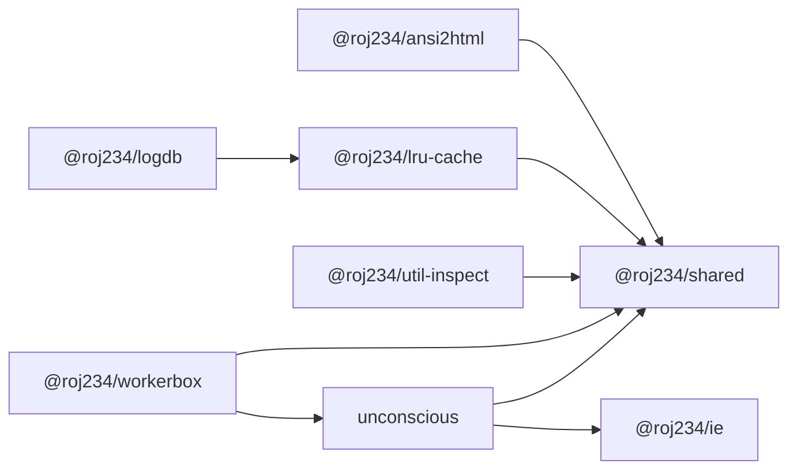

# roj234

一堆各自独立的 JavaScript 包，碰巧住在同一个文件夹里。

严格来说这不算一个工程化的 monorepo：没有根 `package.json`、没有 workspace 配置、没有统一构建，也没有 CI。每个子目录都是一个可以单独 `npm install`、单独发布的 ESM 包，彼此之间只通过 `@roj234/*` 的包名引用。

共同点大概只有这些：

- 对体积和性能比较敏感，能不加依赖就不加
- 文档稀少，很多行为要自己翻源码或 commit history

## 包一览

| 包 | 版本 | 简介 |
| --- | --- | --- |
| [unconscious](./unconscious) | 2.0.0 | 直接操作真实 DOM 的响应式框架，无虚拟 DOM，压缩后 9.5KB |
| [@roj234/ie](./ie) | 0.1.0 | 极简 Vite 类似物，支持 dev / build / preview 和 HMR |
| [@roj234/mdstream](./mdstream) | 1.2.5 | 面向 LLM 流式输出的增量 Markdown 渲染器 |
| [@roj234/ws](./ws) | 1.0.0 | 兼容 `ws` API 的 WebSocket 实现 |
| [@roj234/logdb](./logdb) | 1.0.0 | 按 id / owner / time 查询的追加式日志与 Blob 存储 |
| [@roj234/lru-cache](./lru-cache) | 1.0.0 | 带 TTL 的 LRU 缓存，直接扩展 `Map` |
| [@roj234/workerbox](./workerbox) | 1.0.0 | 不使用 eval 的 WebWorker 沙箱，24KB |
| [@roj234/sadbox](./sadbox) | 0.1.0 | 基于写时复制（COW）的 Agent 沙箱 |
| [@roj234/web-audio-engine](./web-audio-engine) | 1.0.0 | `OfflineAudioContext` 实现（100% AI 生成，未 review） |
| [@roj234/ansi2html](./ansi2html) | 1.0.0 | ANSI 转义序列转 HTML |
| [@roj234/fetch-proxy](./fetch-proxy) | 1.0.0 | 基于 `node:http(s)` 的 fetch，附带 SOCKS5 agent |
| [@roj234/util-inspect](./util-inspect) | 1.0.0 | 把值打印成 JSON5 风格的字面量 |
| [@roj234/shared](./shared) | 1.0.0 | 到处都在用的小工具集合（CC0） |

## 各包是干什么的

### 界面与框架

**[unconscious](./unconscious)** —— 这个仓库里体量最大、文档也相对最多的项目。它用真实 DOM 做细粒度更新，没有 VDOM 和 diff，语法上是一个“参考了 Svelte 的 Vue 风味 React”。`$state` / `$computed`、JSX 事件装饰器、动画、store、虚拟列表都在里面。配套的 [ie](./ie) 是它现在用的构建工具：一个只实现作者用得到的那部分 Vite API 的替代品，默认读 `vite.config.js`，兼容部分 Vite 插件。

### 文本与网络

**[mdstream](./mdstream)** —— 为聊天场景重写的流式 Markdown 解析器，边收 token 边渲染。相比常见实现更在意 XSS / ReDoS 和中文回复里常见的加粗、斜体边界问题，不追求 CommonMark 完整兼容。[**ws**](./ws) 是对 `ws` 的兼容重写，重点在接收缓冲、mask/unmask 和分片处理，额外提供 `bufferreleased`、`partialmessage` 等事件。[**ansi2html**](./ansi2html) 把终端颜色输出转成 HTML，[**fetch-proxy**](./fetch-proxy) 则在 Node 上补了一个基于 `http`/`https` 的 fetch，并带 SOCKS5 代理支持。

### 存储与运行时

**[logdb](./logdb)** 是一个专用的 TSDB：只服务「按 id / owner / 时间查日志」这一种场景，靠定长索引块和顺序写入换取体积和查询性能。[**lru-cache**](./lru-cache) 是为它准备的基础件，支持 TTL、容量淘汰，以及用 TypedArray 存 key/value。[**workerbox**](./workerbox) 把不可信代码放进 WebWorker，提供模拟的 `fs` / `path` / `Buffer`、按需模块加载和权限控制；[**sadbox**](./sadbox) 则把沙箱下沉到操作系统层，Windows 用 Sandboxie，Linux 用 bwrap + overlayfs，让 Agent 随便折腾、宿主不受影响。

另外两个比较独立的：**[util-inspect](./util-inspect)** 用来把对象打印成能直接粘回代码里的字面量；**[web-audio-engine](./web-audio-engine)** 是一个 `OfflineAudioContext` 实现，作者明确标注全部由 AI 生成且尚未 review，使用前请自行评估。

## 包之间的依赖



`unconscious/common` 里还有一批零散模块（msgpack、zip、虚拟列表等），`workerbox` 就借用了其中的 Base64 和 path 工具。其余包（`ws`、`mdstream`、`sadbox`、`web-audio-engine`、`fetch-proxy`）没有实际使用的内部依赖。

## 使用

没有根级安装这一步，进哪个目录就装哪个：

```bash
cd unconscious
npm install
npm run example
```

```bash
cd mdstream
npm install
npm test
```

包的入口、导出和类型都以各自 `package.json` 的 `exports` 为准。想快速了解 API，直接看 `types/` 或 `types.d.ts`，比 README 可靠。

## 一些需要知道的事

- **类型即文档**。除了 `unconscious`，其余包的文档基本只有子目录 README 和 `.d.ts`，而且可能落后于代码。
- **AI 参与的部分有标注**。`sadbox` 的 Linux 实现和 `web-audio-engine` 是 AI 生成的；后者作者自己也没 review 过。`sadbox` 在 Linux 上 `start()` 是异步的，Windows 上仍是同步返回 PID。
- **`ie` 的 `@fs` 没有权限控制**，能读任意文件，只适合本机开发，别直接开到公网。
- **`logdb` 单条数据上限 255 字节**，修改和删除会重建后续数据，且没有完整的崩溃保护。
- **依赖声明不一定准**。例如 `util-inspect` 源码用了 `@roj234/shared` 但没在 `dependencies` 里声明；`fetch-proxy` 声明了 `shared` 却没用。从干净环境安装时留意一下。
- **许可证不统一**。`unconscious` 是 BSD-3-Clause，`mdstream` 是 BSD-3，`sadbox` 是 MIT，`shared` 是 CC0；其余包没写 license 字段，用之前最好先问作者。